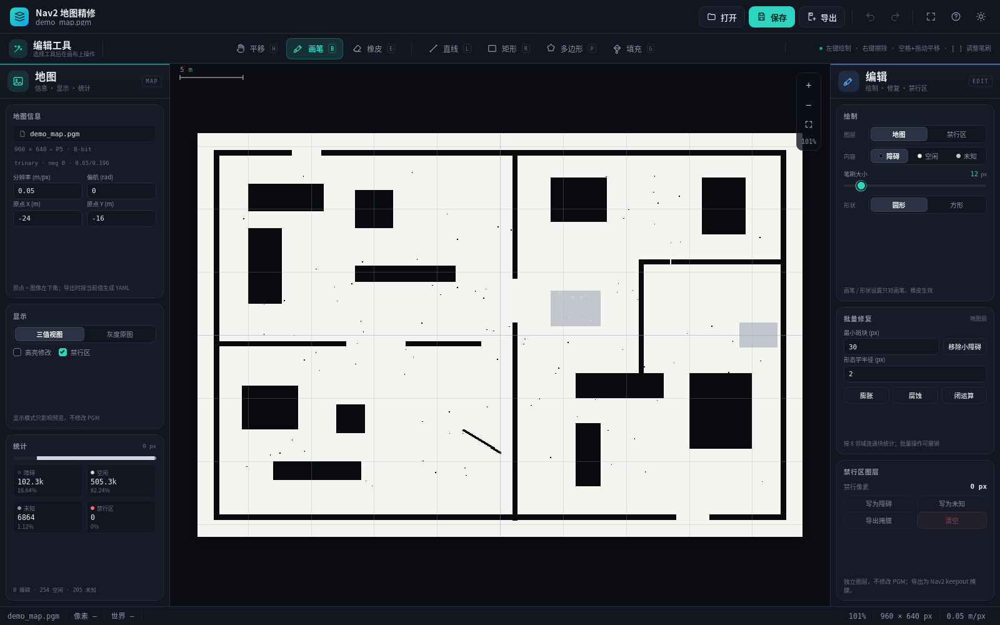
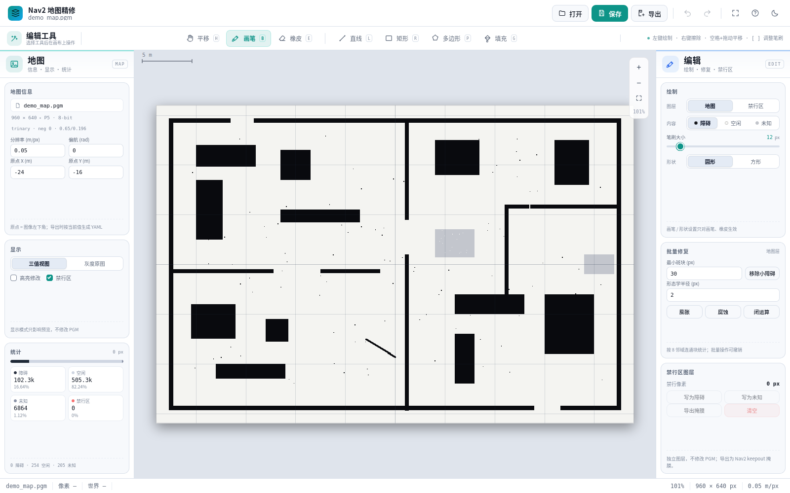
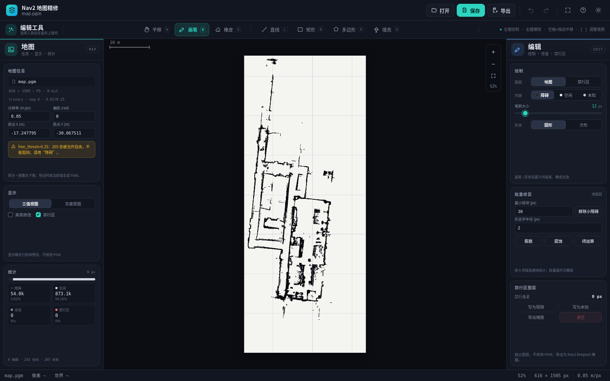
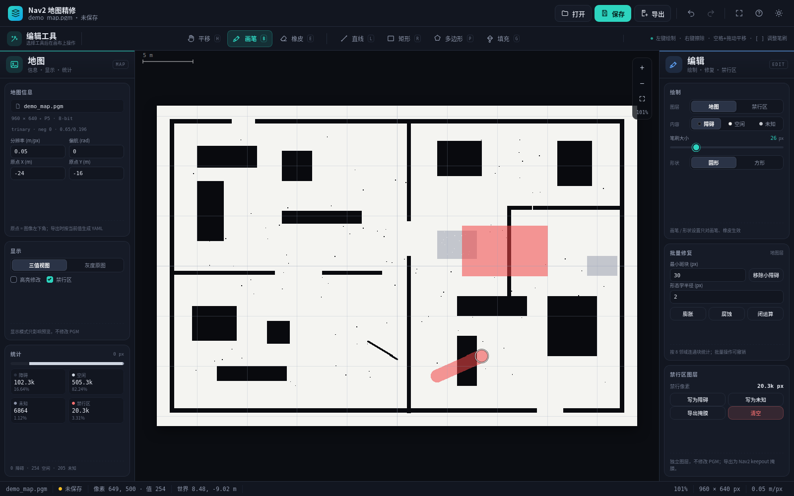

# PGM_EDITOR

**Nav2 / ROS 2 PGM 2D 地图精修工具** — 单文件浏览器应用，用于清理建图噪点、补墙、圈禁行区。

[](LICENSE)




*顶部工具栏 / 左侧地图列 / 中间画布 / 右侧编辑列；1366×768 及以上窗口无需滚动。*

---

## 特性

- **单文件、零运行依赖**：`map_editor.html` 内联了全部 HTML / CSS / JS / 图标，离线可用，x86 与 ARM 通用。
- **不引入私有格式**：输入、输出都是 Nav2 原生的 `.pgm + .yaml`。
- **精修工具**：画笔、橡皮、直线、矩形、多边形、油漆桶；左键绘制，右键擦除；完整撤销 / 重做。
- **批量修复**：移除小障碍（清理建图像素噪点）、膨胀、腐蚀、闭运算（修补墙体缝隙）。
- **禁行区图层**：独立红色标注层，不修改 PGM；可导出 Nav2 `keepout_filter` 掩膜，或一键写回地图。
- **元数据编辑**：读取并保留 YAML 的 `resolution`、`origin`、`negate`、阈值、`mode`；导出时重新生成 YAML。
- **配对保护**：只选 PGM 时会弹窗拦截，避免地图原点和分辨率丢失。
- **固定命名**：导出统一为 `map.pgm` / `map.yaml`，掩膜为 `map_keepout.pgm` / `map_keepout.yaml`。
- **开发板友好**：板子只需 Python 3 标准库即可启动一个可远程访问的地图目录服务；保存直接写回板子并自动备份。
- **本地处理**：不上传地图，不依赖任何在线服务。

---

## 快速开始

### 方式一：直接用

1. 下载或克隆本仓库。
2. 双击 `map_editor.html`（Chrome / Edge / Firefox）。
3. 点“打开” → “选择 .pgm + .yaml 文件…”，**同时选中 PGM 和同名 YAML**。

> **必须同时打开 `.pgm` 与同名 `.yaml`。**
> 只选 PGM 会丢失原点和分辨率，地图在 RViz / Nav2 中会错位。编辑器会弹出确认框；
> 选择“仍然打开”才会使用默认值（0.05 m/px、原点 0,0）。

4. 编辑后点“保存”：浏览器会下载 `map.pgm` + `map.yaml`。
   如果浏览器提示“允许多个下载”，请允许。

### 方式二：服务器模式（推荐，开发板 / 远程）

```bash
python3 serve.py --dir /path/to/maps
```

浏览器打开打印出的地址即可。服务会**递归列出目录中的 `.pgm`**，并自动配对同名 `.yaml`。
保存会直接写回地图所在目录，并在 `.mapedit_backup/` 保留带时间戳的备份。

### 方式三：GitHub Pages（只读预览 / 在线使用）

仓库是纯静态文件，可开启 GitHub Pages：

1. 仓库 **Settings → Pages**；
2. Source 选择 `Deploy from a branch`，分支 `main`，目录 `/ (root)`；
3. 稍后访问：

```text
https://<your-github-username>.github.io/PGM_EDITOR/map_editor.html
```

> GitHub Pages 只有静态文件，没有 `serve.py` 的 `/api`，因此页面运行在“本地文件模式”：
> 打开本地 PGM/YAML 仍可用，保存会走浏览器下载。数据不会上传。

---

## 界面

```text
┌──────────────────────────────────────────────────────────────┐
│ 文件操作：打开 / 保存 / 导出 / 撤销 / 重做 / 适应 / 帮助 ...   │
├──────────────────────────────────────────────────────────────┤
│ 编辑工具（大标题）   [平移] [画笔] [橡皮] | [直线] [矩形] ...  │ 当前提示
├────────────────┬───────────────────────────┬─────────────────┤
│ 地图            │                           │ 编辑            │
│ 地图信息        │                           │ 绘制            │
│ 显示            │          画布             │ 批量修复        │
│ 统计            │                           │ 禁行区图层      │
├────────────────┴───────────────────────────┴─────────────────┤
│ 状态栏：像素坐标 / 世界坐标 / 缩放 / 尺寸                     │
└──────────────────────────────────────────────────────────────┘
```

- **顶部工具栏**：左侧是醒目的「编辑工具」标题，中间是居中的工具组，右侧是当前工具提示；
- **左列「地图」**：地图信息、显示、统计三张独立卡片；
- **右列「编辑」**：绘制、批量修复、禁行区图层三张独立卡片；
- 每列有醒目的大标题和彩色顶线；列内三张卡片有独立边框、标题和间距，按比例铺满整列；
- 1366×768 及以上窗口无需滚动，所有信息一屏可见。

<details>
<summary>更多截图（浅色主题 / 真实地图 / 禁行区）</summary>







</details>

---

## 工具与快捷键

| 工具 | 快捷键 | 说明 |
|---|---|---|
| 平移 | `H` | 拖动平移；空格 + 拖动 / 中键拖动同样可用 |
| 画笔 | `B` | 圆形 / 方形，1–120 px；左键绘制、右键擦除 |
| 橡皮 | `E` | 恢复为空闲（254） |
| 直线 | `L` | 拖出墙线，线宽可调 |
| 矩形 | `R` | 填充或只描边 |
| 多边形 | `P` | 逐点单击；`Enter` / 双击 / 点回起点闭合；右键删点 |
| 油漆桶 | `G` | 按像素值 + 容差填充连通区域 |

| 操作 | 快捷键 |
|---|---|
| 撤销 / 重做 | `Ctrl+Z` / `Ctrl+Shift+Z` |
| 保存 / 导出 | `Ctrl+S` / `Ctrl+Shift+S` |
| 打开 | `Ctrl+O` |
| 适应窗口 | `F` |
| 笔刷大小 | `[` / `]` |
| 选择像素值 | `1` / `2` / `3`（障碍 / 空闲 / 未知） |
| 取消当前操作 | `Esc` |

---

## 与 Nav2 配合

### PGM 像素约定

标准 `map_server`（`negate: 0`）：

| 像素值 | 含义 |
|---|---|
| `0` | 障碍 |
| `254` / `255` | 空闲 |
| `205` | 未知 |

编辑器导出 8 位 `P5` PGM，并按当前分辨率、原点、阈值重新生成 YAML。

### `free_thresh` 与“未知”

```text
occupancy = (255 - pixel) / 255
occupied  if occupancy > occupied_thresh
free      if occupancy < free_thresh
unknown   otherwise
```

`205` 的 occupancy ≈ 0.196：

- `free_thresh ≤ 0.196`：205 是未知；
- `free_thresh > 0.196`（例如 `0.25`）：**205 会被 Nav2 判为自由**。

如果使用“未知”阻挡通行，请注意这一点。编辑器会在右侧给出提示；此时请改用“障碍”，或把 `free_thresh` 调整到 0.196。

### keepout_filter 配置示例

用“禁行区 → 导出掩膜”得到 `map_keepout.pgm` / `map_keepout.yaml`，然后在 Nav2 参数中启用
`KeepoutFilter`。完整示例见 [`examples/keepout_filter_params.yaml`](examples/keepout_filter_params.yaml)：

```yaml
local_costmap:
  local_costmap:
    ros__parameters:
      filters: ["keepout_filter"]
      keepout_filter:
        plugin: "nav2_costmap_2d::KeepoutFilter"
        enabled: True
        filter_info_topic: "/costmap_filter_info"

filter_mask_server:
  ros__parameters:
    frame_id: "map"
    topic_name: "/keepout_filter_mask"
    yaml_filename: "/absolute/path/to/map_keepout.yaml"

costmap_filter_info_server:
  ros__parameters:
    type: 0                 # 0 = keepout
    filter_info_topic: "/costmap_filter_info"
    mask_topic: "/keepout_filter_mask"
    base: 0.0
    multiplier: 1.0
```

- 掩膜图的 `resolution` / `origin` 必须与地图一致（导出时已自动保证）；
- 不同 Nav2 版本的节点名 / 参数名可能略有差异，请以所用版本的官方示例为准。

---

## 开发

运行时无 Python 第三方依赖；服务器只使用标准库。
构建和测试需要 Python 3 与 Node.js。

### 构建单文件

修改 `src/` 后：

```bash
python3 build.py
```

生成或覆盖根目录的 `map_editor.html`。仓库中已经提交了构建产物，普通用户无需执行。

### 测试

```bash
node tests/test_core.js
```

覆盖 PGM / YAML 编解码、泛洪填充、小障碍移除、形态学、真实地图字节级往返和大图性能。

### 源码结构

- `src/core.js` — PGM / YAML 编解码、泛洪、形态学（无 DOM，可在 Node 运行）
- `src/app.js` — 画布、工具、撤销、文件与服务器交互
- `src/index.html` — 页面骨架与 SVG 图标
- `src/style.css` — 界面样式
- `serve.py` — 可选服务（本地 / 开发板）
- `build.py` — 内联打包
- `tests/test_core.js` — 核心算法测试

### 提交前检查

```bash
python3 build.py
node tests/test_core.js
git diff --stat
```

如果修改了 `src/`，请同时提交重新生成的 `map_editor.html`，保证“下载即用”。

仓库自带 GitHub Actions（`.github/workflows/ci.yml`）：每次 push / PR 会运行核心算法测试，
并检查 `map_editor.html` 是否与 `src/` 同步。

---

## 目录结构

```text
PGM_EDITOR/
├── map_editor.html          # 构建产物，双击即用
├── serve.py                 # 可选本地 / 开发板服务
├── build.py                 # 打包脚本
├── src/
│   ├── index.html
│   ├── style.css
│   ├── core.js
│   └── app.js
├── tests/
│   └── test_core.js
├── docs/                    # 界面截图
├── examples/
│   └── keepout_filter_params.yaml
├── .github/workflows/ci.yml # GitHub Actions：测试 + 构建一致性检查
├── README.md
├── LICENSE
└── .gitignore
```

---

## 开发板使用

适用于 Jetson、树莓派、RK3588 等能运行 Python 3 的板子。**板子不需要浏览器、图形界面或 ROS。**

### 1. 拷贝

```bash
scp -r PGM_EDITOR user@board:~/
```

### 2. 启动

```bash
ssh user@board
cd ~/PGM_EDITOR
python3 serve.py --dir ~/JC05/maps --host 0.0.0.0 --port 8765
```

启动后会打印本机与局域网地址。

- `--dir` 指向地图根目录即可，服务会递归列出子目录里的 `.pgm`；
- 同名 `.yaml` 自动配对；
- 默认端口 8765，冲突可改 `--port 8777`；
- 从电脑访问必须加 `--host 0.0.0.0`；
- 板子防火墙需放行该端口（如 `ufw allow 8765/tcp`）。

### 3. 在电脑上编辑

浏览器打开：

```text
http://<板子的IP>:8765/
```

“打开” → “开发板目录” → 选择地图 → 编辑 → 保存。

保存会写回地图所在子目录，文件名固定为 `map.pgm` / `map.yaml`，并自动备份到 `--dir/.mapedit_backup/`。

### 4. 停止

板子终端按 `Ctrl+C`。

> ⚠️ 服务器没有登录认证，任何能访问端口的人都可以读写 `--dir` 下的地图。请只在可信局域网使用。

---

## 常见问题

**保存后的文件在哪里？**

- 直接打开 HTML：下载到浏览器下载目录（`map.pgm` + `map.yaml`）；
- 服务器模式：直接写回地图目录，并在 `.mapedit_backup/` 保留备份。

**为什么文件名总是 `map`？**

按 Nav2 约定固定为 `map.pgm` / `map.yaml`，避免导出后还要改名。服务器模式会保留地图所在的子目录。

**画了“未知”但机器人还是能过去？**

见上文 `free_thresh` 说明。请改用“障碍”，或把 `free_thresh` 调整为 0.196。

**能处理多大的地图？**

实测 4880×2410（约 11.8 M 像素，12 MB）载入约 0.2 s。更大的地图主要受浏览器单画布内存限制。

**支持哪些浏览器？**

Firefox 158 完整验证；Chrome / Edge 使用标准 Canvas / File / `<dialog>` API，预期兼容。
服务端需要 Python 3.8+。

**服务器端口被占用？**

```bash
python3 serve.py --dir ~/maps --port 8777
```

**禁行区会破坏原地图吗？**

不会。禁行区是独立图层，只有主动点击“写为障碍 / 写为未知”才会写入 PGM；导出掩膜也不会修改原地图。

**界面太小 / 想收起两侧栏？**

当前版本在 1366×768 及以上保持两列三卡片全部可见；更小的窗口会压缩列宽，卡片内部可按需滚动。
如果需要更激进的移动端布局，欢迎提交 Issue / PR。

---

## 安全

- 编辑器不联网、不上传地图；
- 服务器模式没有认证，仅用于可信局域网；
- 修改地图前建议保留原始文件备份；服务器会自动备份。

---

## Contributing

欢迎 Issue 和 PR。提交前请：

1. 修改 `src/`；
2. 运行 `node tests/test_core.js`；
3. 运行 `python3 build.py` 并提交更新后的 `map_editor.html`；
4. 保持 UI 的“工具条 + 左地图列 + 中画布 + 右编辑列”结构和固定导出命名。

如果这个工具对你有帮助，欢迎 Star ⭐。

---

## License

[MIT](LICENSE) © 2026 PGM_EDITOR contributors
